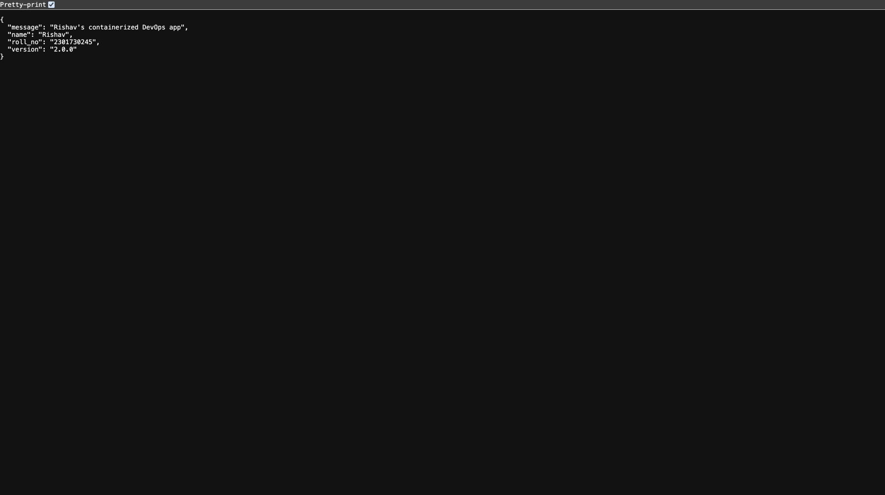
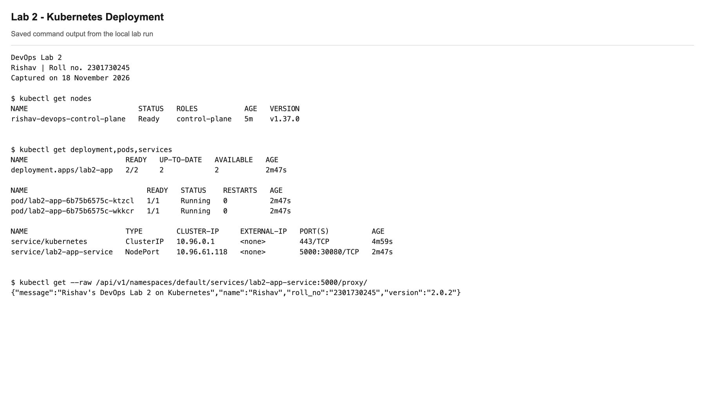

# Lab 2 screenshots

Rishav | Roll no. 2301730245

Captured from the local lab runs. The browser pages show the running tools and apps. Screenshots headed "Saved command output" show the stdout saved in [docs/commands](../commands/) from those runs.

**Git and tests**

**Container app**

**Docker containers**

**Image push**

**Storage**

**Kubernetes deployment**

**Kubernetes scaling**

**Rolling update**

**Jenkins stages**

