# Lab 2 screenshots

Rishav | Roll no. 2301730245

Captured from the actual local runs. Saved-command-output pages show the stdout kept in [command records](../commands/).

**q0 git and tests**

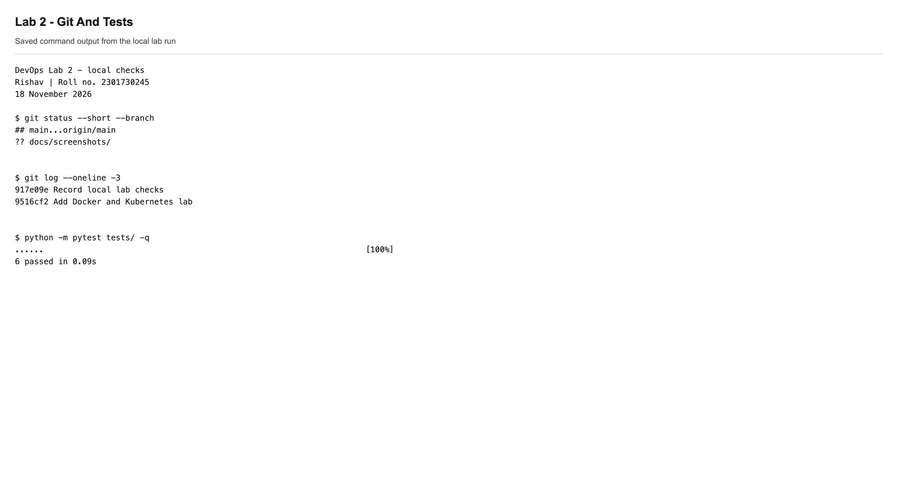

**q1 container app**

**q1 image layers**

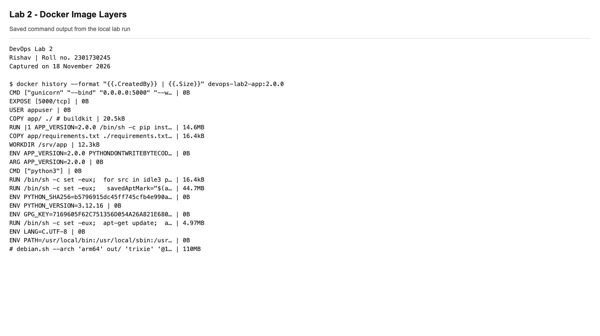

**q2 docker containers**

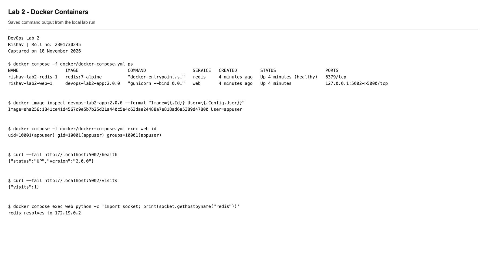

**q2 image push**

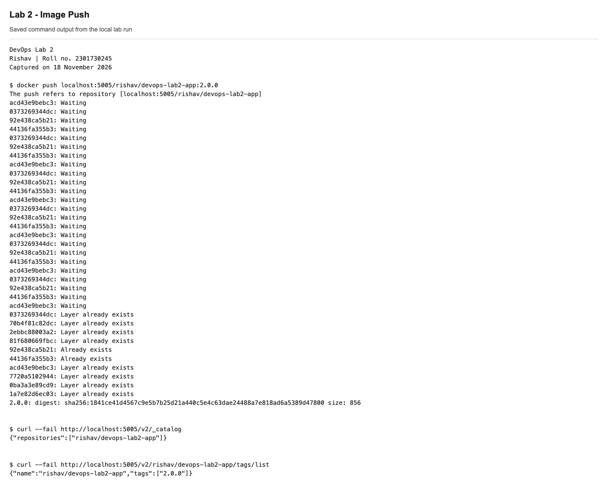

**q3 storage complete**

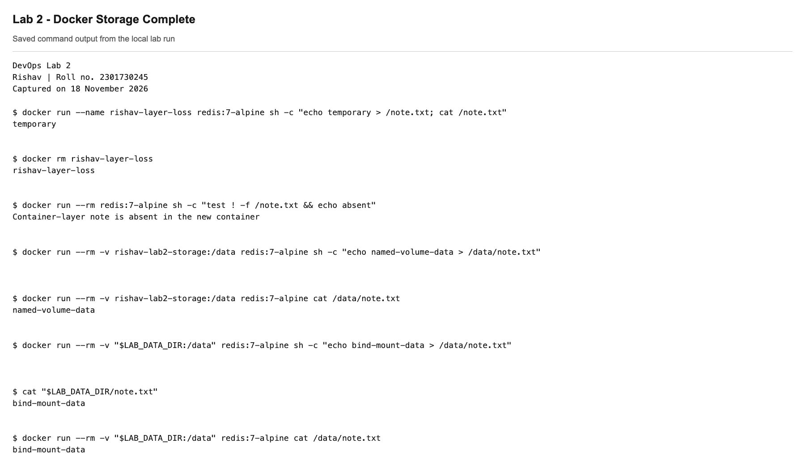

**q3 storage**

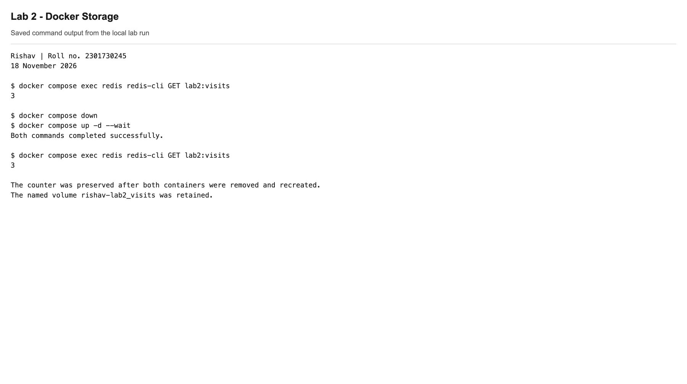

**q4 network name ip**

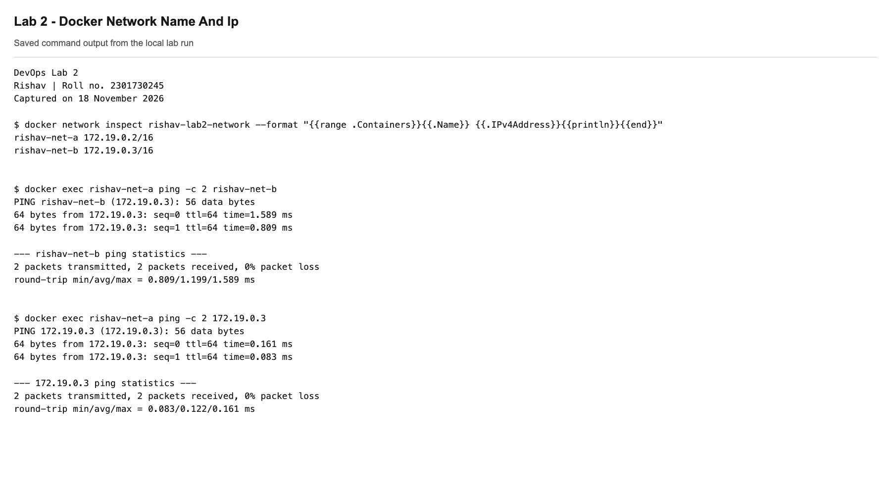

**q5 kubernetes deployment**

**q5 minikube deployment**

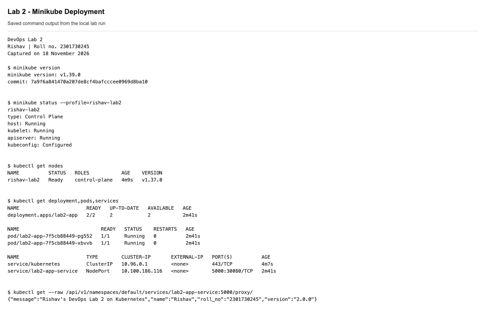

**q6 kubernetes scaling**

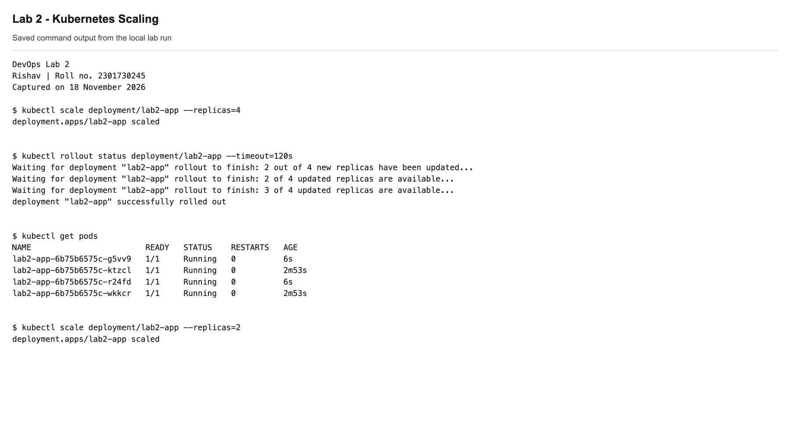

**q6 rolling update**

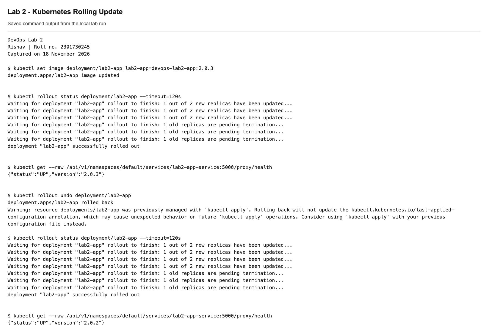

**q7 jenkins stages**

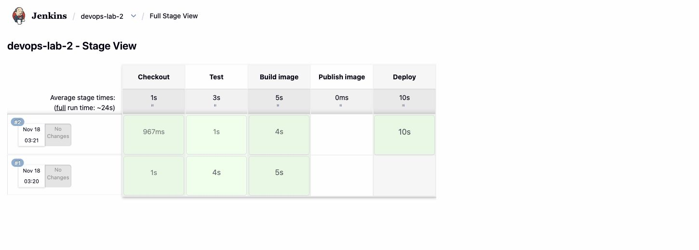

**q7 scm build**

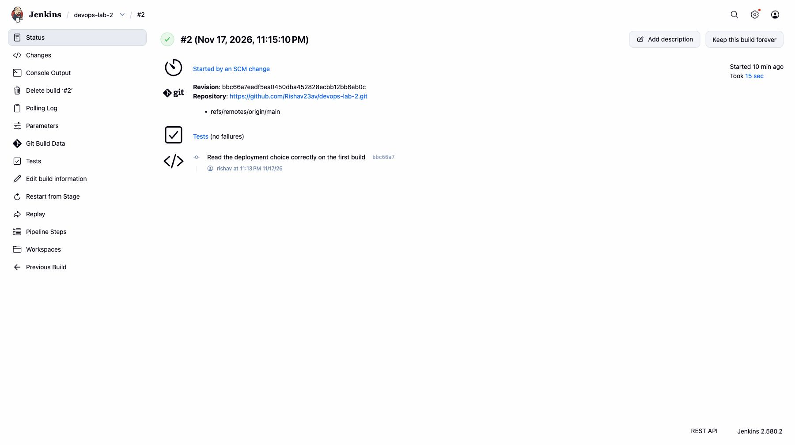

**q7 scm trigger**

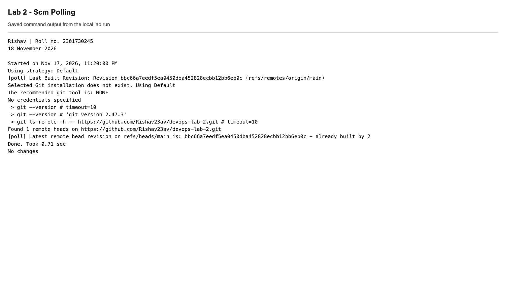
